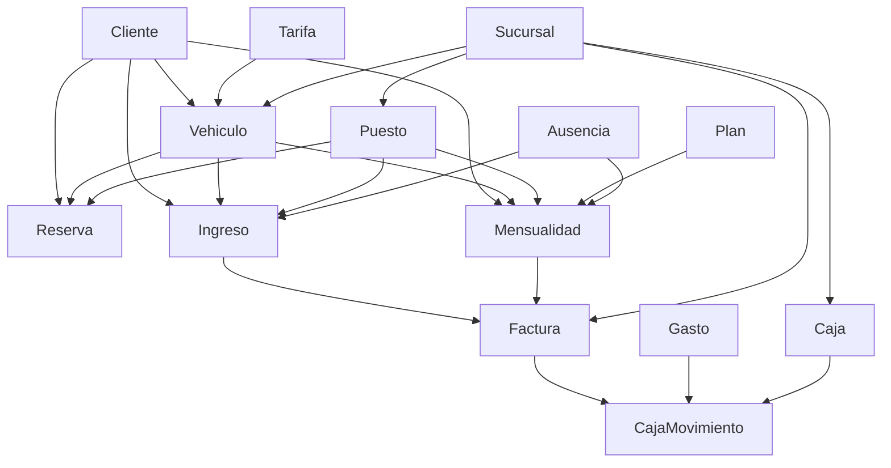

# 04 — Procesos del negocio

> Secuencias reales extraídas de los controladores. Para cada proceso se indica la secuencia y sus dependencias.

---

## 1. Registro de cliente
`POST /api/clientes` → `crearCliente`.
1. Valida nombres/apellidos/documento (schema).
2. Verifica documento único.
3. Crea `Cliente` (estado ACTIVO).
4. Si `deseaReservar`, crea una `Reserva` con el primer vehículo del cliente (si existe).
5. Registra en `Movimiento` (CLIENTES/CREAR).
**Dependencias**: vehículos (opcional), reservas (opcional).

## 2. Edición de cliente
`PUT /api/clientes/:id` → `actualizarCliente`. Actualiza campos permitidos; si `deseaReservar=true` crea reserva (sin duplicar PENDIENTE/CONFIRMADA); si `false` cancela reservas PENDIENTE/CONFIRMADA. No modifica `documento`.

## 3. Registro de vehículo
`POST /api/vehiculos` → `crearVehiculo`.
1. Valida placa única (error nombra al dueño).
2. Verifica cliente.
3. Opcional: valida y asigna `planId`/`tarifaId`; setea `tipoCobro` y `creadoPorPlan`.
4. Crea `Vehiculo` y registra `Movimiento`.

## 4. Asociación vehículo–cliente
Un vehículo pertenece a **un** cliente (`Vehiculo.clienteId` obligatorio). El cambio de propietario se hace editando `clienteId` (no hay historial de propietarios — ver documento 12).

## 5. Registro de ingreso (entrada)
`POST /api/ingresos` → `registrarIngreso`.
1. Valida cliente (no bloqueado), vehículo (del cliente, activo, no bloqueado, misma sucursal).
2. Detecta **reserva activa** y/o **mensualidad vigente** con puesto → fija el puesto obligatoriamente.
3. Rechaza si el vehículo ya está dentro.
4. Transacción: advisory locks (vehículo 78124021, puesto 78124020), relee reserva/mensualidad, verifica disponibilidad del puesto, ocupa el puesto (`updateMany` condicional).
5. Crea `Ingreso` (ACTIVO); si venía de reserva, la marca ACTIVA.
6. Registra `Movimiento` y emite `ingreso:entrada` por socket.
**Dependencias**: cliente, vehículo, puesto, reserva, mensualidad, caja (indirecta).

## 6. Asignación de puestos
Automática según reserva/mensualidad o manual (puesto LIBRE). Al ocupar se valida que no haya ingreso/mensualidad/reserva vigente. Estado del puesto pasa a OCUPADO.

## 7. Registro de salida (con cobro)
`POST /api/ingresos/salida-con-cobro/:id` → `registrarSalidaConCobro`.
1. Detecta mensualidad vigente → `cubiertoPorPlan` (cobro 0) o cobra por tarifa.
2. Transacción con locks (vehículo, puesto, caja global 78124019), fija `fechaSalida` tras los locks.
3. Revalida que la cobertura del plan no cambió (FOR UPDATE en Mensualidad).
4. Recalcula cobro; bloquea cliente `FOR UPDATE` para descontar saldo.
5. Marca ingreso FINALIZADO; recalcula puesto (OCUPADO/RESERVADO/LIBRE).
6. Si no cubierto: crea `Factura` (FACT) + `CajaMovimiento` (INGRESO); exige caja abierta.
**Dependencias**: ingreso, puesto, mensualidad, tarifa, cliente, factura, caja.

## 8. Cálculo de tarifas
`services/calculadorCobros.ts` (ver documento 05 y 09). Se invoca en simular/salida.

## 9. Registro de pago
- **Salida ocasional**: el pago se registra al cobrar la salida (factura `FACT` + movimiento de caja).
- **Suscripción**: `POST /api/mensualidades/cobrar/:id` → factura `FACT-MEN` + movimiento; abono parcial permitido; al saldar renueva automáticamente.

## 10. Generación de facturas
- Automática: `FACT` (salidas/facturas de ausencia), `FACT-MEN` (cobro de suscripción), `MENSUALIDAD_AUTO` (facturas pendientes por `generar-facturas`).
- Numeración: `services/facturaCounter.ts` con secuencia Postgres por prefijo.
- Facturas nacen **solo** desde ingresos, mensualidades y ausencias (no hay endpoint de creación en el módulo facturas).

## 11. Gestión de planes
`modules/planes`: CRUD; DELETE desactiva si hay mensualidades activas. Los planes definen duración/valor usados en creación/renovación de mensualidades.

## 12. Renovaciones
`PUT /api/mensualidades/renovar/:id`:
- Calcula nuevo periodo desde `fechaFin` (o ahora si ya venció) + `sumarMesesConTope`.
- Crea **nueva** `Mensualidad` (conserva la histórica y sus facturas).
- Marca la anterior VENCIDA si correspondía; ajusta puesto (OCUPADO/RESERVADO).
- También hay renovación implícita al **saldar** el cobro (`cobrarMensualidad` renueva por `plan.duracionDias`).

## 13. Vencimientos
`scheduler.ts` cada 10 min: mensualidades ACTIVA con `fechaFin < ahora` → VENCIDA + recalcula puesto; reservas PENDIENTE/CONFIRMADA cuyo límite de llegada pasó → CANCELADA/NO_SHOW.

## 14. Reservas
`modules/reservas`: crear (fecha futura, sin solapes), confirmar, activar (crea ingreso y ocupa puesto), finalizar (tras la salida), cancelar/eliminar, liberar vencidas. Estados PENDIENTE→CONFIRMADA→ACTIVA→FINALIZADA / CANCELADA / NO_SHOW.

## 15. Ausencias
`modules/ausencias`: crear (si hay ingreso activo, lo finaliza con factura y deja el puesto en AUSENCIA), finalizar (aplica opción sobre la mensualidad), editar, eliminar (solo admin).

## 16. Gestión de caja
Abrir (con contraseña, una por sucursal) → operar (ingresos por salidas/suscripciones, egresos por gastos) → cerrar (arqueo, diferencia). Cajas cerradas inmutables.

## 17. Gastos
Crear (exige caja abierta; EGRESO en caja), recurrentes (`generar-recurrentes`), editar, eliminar (anula movimiento). Vinculados a caja cerrada: inmutable.

## 18. Cierres de caja
`PUT /api/caja/cerrar/:id`: calcula `esperado = apertura + ingresosEfectivo − egresosEfectivo`, valida denominaciones del conteo, guarda `diferencia` en observación, marca CERRADA.

## 19. Reportes
`GET /api/reportes`: resumen por rango (facturas pagadas, gastos, utilidad), serie diaria, ocupación por hora, métodos de pago. Facturas PENDIENTE (sin método) se listan pero no cuentan como ingreso.

## 20. Suscripciones
Equivale al módulo `mensualidades` (UI "Suscripciones"). Ciclo: crear → cobrar (abonos) → renovar → cancelar/eliminar. Puesto fijo opcional.

## 21. Usuarios
CRUD y estado (activar/desactivar), cambio de contraseña, accesos. Protecciones del último admin.

## 22. Roles y permisos
Tres roles (admin, supervisor, empleado). `verificarRol` en backend; Sidebar + ProtectedRoute en frontend (ver documento 07).

## 23. Sucursales
CRUD (solo admin). Base del aislamiento multi-sede. Sin validaciones de negocio en controlador.

## 24. Copias de seguridad
`GET /api/backup` (JSON sin contraseñas) y `POST /api/backup/restaurar` (upsert por id). Scripts `backup-diario.ps1` / `restaurar-backup.ps1` para el Postgres local.

## 25. Auditoría de movimientos
`helpers/movimientos.ts` inserta en `Movimiento` en casi todas las operaciones; `GET /api/movimientos` (admin/supervisor) lo expone.

---

## Diagrama de dependencias (Mermaid)

