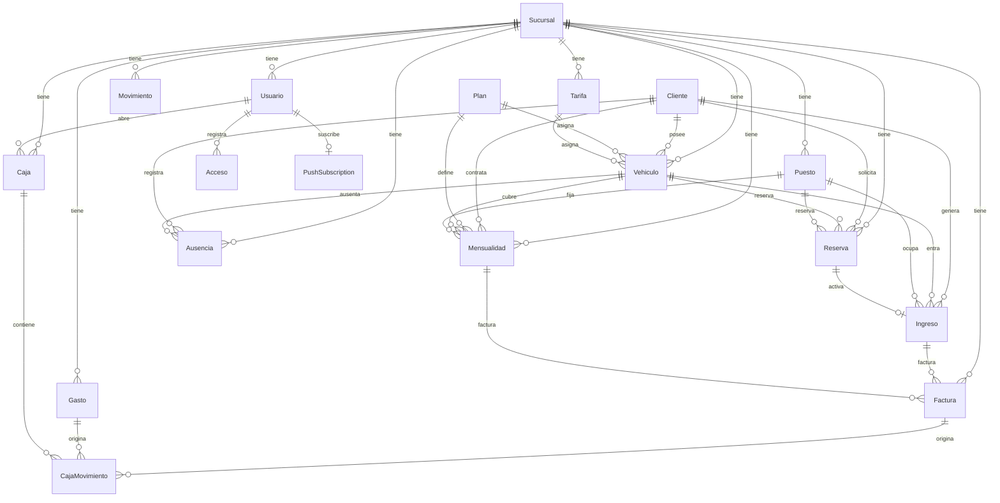

# 06 — Modelo Entidad-Relación

> Fuente única: `backend/prisma/schema.prisma` (386 líneas, 18 modelos). No se modificó el esquema.

## 1. Entidades y campos

### Usuario (`Usuario`)
| Campo | Tipo | Notas |
|---|---|---|
| id | Int PK autoincrement | |
| nombre | String | |
| usuario | String **@unique** | login |
| correo | String **@unique** | |
| password | String | hash bcrypt |
| rol | String default "empleado" | admin/supervisor/empleado |
| estado | Boolean default true | |
| intentosFallidos | Int default 0 | |
| bloqueadoHasta | DateTime? | |
| ultimoAcceso | DateTime? | |
| resetToken | String? | |
| resetTokenExpires | DateTime? | |
| tokenVersion | Int default 0 | invalida sesiones |
| createdAt | DateTime default now | |
| sucursalId | Int? FK→Sucursal | |

Relaciones: `accesos[]`, `cajas[]`, `sucursal?`.

### Acceso (`Acceso`)
id, usuarioId FK→Usuario, usuario (String), actividad, ip?, dispositivo?, createdAt. Rel: `usuarioRel`.

### Configuracion (`Configuracion`) — registro único
~45 campos: identidad (nombreParqueadero, nit, direccion, ciudad, telefono, whatsapp, correo, logo, fondoLogin), tema (colorPrincipal/Secundario/Fondo, modoOscuro, colorFondoLogin, tamanoFuente), formatos (fecha/hora/moneda, zonaHoraria, monedaSimbolo, idioma), notificaciones (5 bool), 7 plantillas WhatsApp, operativa (horarioApertura/Cierre, paginacionPorDefecto, iva, minutosGracia, metodosPago, pieFactura, intentosMaximos), `listasConfiguracion` Json?.

### Cliente (`Cliente`)
id, nombres, apellidos, documento **@unique**, telefono?, email?, direccion?, observaciones?, deseaReservar (bool), estado default "ACTIVO", createdAt, bloqueado (bool), saldo Float? default 0.
Rel: `ausencias[]`, `ingresos[]`, `mensualidades[]`, `reservas[]`, `vehiculos[]`.

### Vehiculo (`Vehiculo`)
id, placa **@unique**, marca?, modelo?, color?, tipo?, clase?, observaciones?, estado default true, clienteId FK, sucursalId? FK, creadoPorPlan default false, tipoCobro? (PLAN/TARIFA/NINGUNO), planId? FK, tarifaId? FK, createdAt, bloqueado default false.
Rel: `ausencias[]`, `ingresos[]`, `mensualidades[]`, `reservas[]`, `cliente`, `sucursal?`, `plan?`, `tarifa?`.

### Puesto (`Puesto`)
id, codigo **@unique**, estado default "LIBRE", observacion?, createdAt, activo default true, tipoPuesto (String), updatedAt, sucursalId? FK, zona?.
Rel: `ingresos[]`, `mensualidades[]`, `reservas[]`, `sucursal?`.

### Ingreso (`Ingreso`)
id, clienteId FK, vehiculoId FK, puestoId FK, reservaId? **@unique** FK, fechaEntrada default now, fechaSalida?, estado default "ACTIVO", createdAt, tiempoMinutos?, valorPagado?, ticketExtraviado default false.
Rel: `facturas[]`, `cliente`, `puesto`, `reserva?`, `vehiculo`.

### Tarifa (`Tarifa`)
id, nombre, tipoVehiculo, modalidad, valor, minutosCortesia? default 0, descripcion?, activa default true, sucursalId? FK, createdAt, updatedAt, minutosGratis? default 0, precioHoraAdicional?, precioPrimeraHora?, tarifaMaximaDiaria?.
Rel: `sucursal?`, `vehiculos[]`.

### Caja (`Caja`)
id, apertura, cierre?, estado default "ABIERTA", usuarioId FK, observacion?, sucursalId? FK, createdAt, updatedAt.
Rel: `sucursal?`, `usuario`, `movimientos[]`.

### CajaMovimiento (`CajaMovimiento`)
id, cajaId FK (onDelete Cascade), tipo, concepto, monto, metodoPago?, facturaId? FK, gastoId? FK, anulado default false, anuladoEn?, anuladoPor?, motivoAnulacion?, createdAt.
Índices: `@@index([cajaId])`, `@@index([cajaId, anulado])`. Rel: `caja`, `factura?`, `gasto?`.

### Plan (`Plan`)
id, nombre, descripcion?, duracionDias, valor, tipoVehiculo default "todos", activo default true, createdAt, updatedAt.
Rel: `mensualidades[]`, `vehiculos[]`.

### Mensualidad (`Mensualidad`)
id, clienteId FK, vehiculoId FK, planId? FK, puestoId? FK, fechaInicio, fechaFin, valor, estado default "ACTIVA", observacion?, sucursalId? FK, createdAt, updatedAt.
Rel: `facturas[]`, `cliente`, `plan?`, `puesto?`, `sucursal?`, `vehiculo`.

### Gasto (`Gasto`)
id, concepto, categoria default "otros", descripcion?, valor, fecha default now, sucursalId? FK, createdAt, updatedAt, periodicidad?, proximaGeneracion?, recurrente default false.
Rel: `cajaMovimientos[]`, `sucursal?`.

### Movimiento (`Movimiento`)
id, modulo, accion, descripcion, usuario?, sucursalId? FK, createdAt. Rel: `sucursal?`.

### Factura (`Factura`)
id, numero **@unique**, ingresoId? FK, mensualidadId? FK, origen default "INGRESO", valor, metodoPago?, sucursalId? FK, createdAt.
Rel: `cajaMovimientos[]`, `ingreso?`, `mensualidad?`, `sucursal?`.

### Reserva (`Reserva`)
id, clienteId FK, vehiculoId? FK, puestoId? FK, fechaReserva default now, fechaInicio, fechaFin?, estado default "PENDIENTE", observaciones?, sucursalId? FK, createdAt, updatedAt.
Rel: `ingreso?`, `cliente`, `puesto?`, `sucursal?`, `vehiculo?`.

### PushSubscription (`PushSubscription`)
id, usuarioId **@unique**, subscription Json, createdAt, updatedAt.

### Ausencia (`Ausencia`)
id, clienteId FK, vehiculoId FK, fechaSalida, fechaRegreso?, motivo?, estado default "ACTIVA", sucursalId? FK, createdAt, updatedAt, opcion default "HISTORIAL".
Rel: `cliente`, `sucursal?`, `vehiculo`.

### Sucursal (`Sucursal`)
id, nombre, direccion?, telefono?, estado default true, createdAt, updatedAt.
Rel: `ausencias[]`, `caja[]`, `facturas[]`, `gastos[]`, `mensualidades[]`, `movimientos[]`, `puestos[]`, `reservas[]`, `tarifas[]`, `usuarios[]`, `vehiculos[]`.

## 2. Diagrama ER (Mermaid)

## 3. Cardinalidades por relación (significado de negocio)

| Relación | Cardinalidad | Significado |
|---|---|---|
| Cliente–Vehiculo | 1:N | un cliente registra varios vehículos |
| Vehiculo–Ingreso | 1:N | historial de visitas del vehículo |
| Puesto–Ingreso | 1:N (1 activo) | historial de ocupaciones |
| Reserva–Ingreso | 1:0..1 (`@unique reservaId`) | una reserva genera a lo sumo un ingreso |
| Mensualidad–Factura | 1:N | abonos del periodo |
| Ingreso–Factura | 1:N | normalmente 1 factura de salida |
| Factura–CajaMovimiento | 1:N | movimientos ligados a la factura |
| Caja–CajaMovimiento | 1:N (Cascade) | movimientos del turno |
| Plan–Vehiculo / Plan–Mensualidad | 1:N | plan asignado/cubierto |
| Tarifa–Vehiculo | 1:N | tarifa por defecto del vehículo |
| Sucursal–(muchas) | 1:N | multi-sede por FK opcional |

## 4. Restricciones únicas e índices

- `@unique`: `Usuario.usuario`, `Usuario.correo`, `Cliente.documento`, `Vehiculo.placa`, `Puesto.codigo`, `Factura.numero`, `Ingreso.reservaId`, `PushSubscription.usuarioId`.
- Índices: `CajaMovimiento(cajaId)`, `CajaMovimiento(cajaId, anulado)`.
- Claves foráneas con acciones: la mayoría `Restrict`/`SetNull`; `CajaMovimiento.cajaId` y `CajaMovimiento.facturaId` con `Cascade`/`SetNull`.

## 5. Estados y enumeraciones (implementados como String, no enum Prisma)

- **Cliente.estado**: ACTIVO, VENCIDO, SUSPENDIDO, MOROSO, RETIRADO (default ACTIVO).
- **Vehiculo.tipoCobro**: PLAN, TARIFA, NINGUNO (nullable).
- **Puesto.estado**: LIBRE, OCUPADO, RESERVADO, MANTENIMIENTO, AUSENCIA.
- **Ingreso.estado**: ACTIVO, FINALIZADO.
- **Mensualidad.estado**: ACTIVA, VENCIDA, CANCELADA.
- **Reserva.estado**: PENDIENTE, CONFIRMADA, ACTIVA, FINALIZADA, CANCELADA, NO_SHOW.
- **Caja.estado**: ABIERTA, CERRADA.
- **CajaMovimiento.tipo**: INGRESO, EGRESO.
- **Factura.origen**: INGRESO, MENSUALIDAD, MENSUALIDAD_AUTO.
- **Ausencia.estado**: ACTIVA, FINALIZADA; **opcion**: HISTORIAL, EXTENDER, DESCONTAR, CONGELAR, MANTENER.
- **Usuario.rol**: admin, supervisor, empleado.

## 6. Eliminación lógica e historial

- Eliminación lógica (soft): `Usuario.estado`, `Cliente.estado/bloqueado`, `Vehiculo.estado/bloqueado`, `Puesto.activo`, `Tarifa.activa`, `Plan.activo`, `Sucursal.estado`, `CajaMovimiento.anulado`.
- Historial histórico: `Ingreso` (activo/finalizado), `Factura`, `Movimiento`, `Acceso`.
- **No** hay historial de propietarios de vehículo, ni versionado de tarifas/planes.

## 7. Relaciones que podrían faltar / riesgos

| Observación | Tipo | Detalle |
|---|---|---|
| No hay tabla de propietarios históricos del vehículo | Relación faltante | Cambiar `clienteId` pierde el dueño anterior |
| `Factura` no referencia `tarifaId` ni desglose | Modelo | No se puede reconstruir el cálculo (modalidad/minutos) desde la factura |
| `Pago` no es entidad propia | Modelo | El "pago" se modela como `Factura` con `metodoPago`; los abonos múltiples generan varias facturas |
| `CajaMovimiento.facturaId`/`gastoId` sin `@unique` | Integridad | Una factura puede tener varios movimientos (permitido por diseño) |
| `Ingreso` no guarda `tarifaId` usada | Trazabilidad | Cambios de tarifa posteriores no afectan la factura pero impiden reauditoría |
| `Puesto` ↔ `Vehiculo` tipo no validado en BD | Integridad | `tipoPuesto` (texto libre) vs `Vehiculo.tipo` |
| `Mensualidad` sin `@unique` en (vehiculo,puesto,periodo) | Integridad | Evitado por lógica/locks, no por constraint |
| `Reserva` con `vehiculoId`/`puestoId` opcionales | Modelo | Permite reservas sin vehículo/puesto (caso `deseaReservar`) |

## 8. Integridad referencial — puntos de atención

- `Factura.ingresoId` y `mensualidadId` ambos nullable → factura puede no tener origen (no debería por lógica).
- `CajaMovimiento.cajaId` con `Cascade`: borrar una caja borraría sus movimientos; el controlador **impide** borrar cajas, mitigando el riesgo.
- Los borrados en cascada de Prisma por defecto (`Restrict`) obligan a borrar en orden; el `formatearSistema` respeta un orden manual de dependencias.
- `Usuario` con `Caja`/`Acceso` no se puede borrar (Restrict) → el controlador lo detecta (409).
