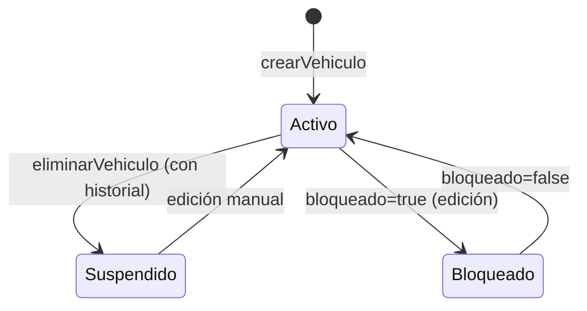
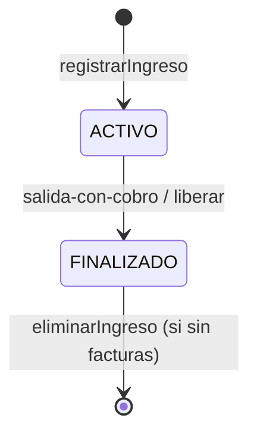
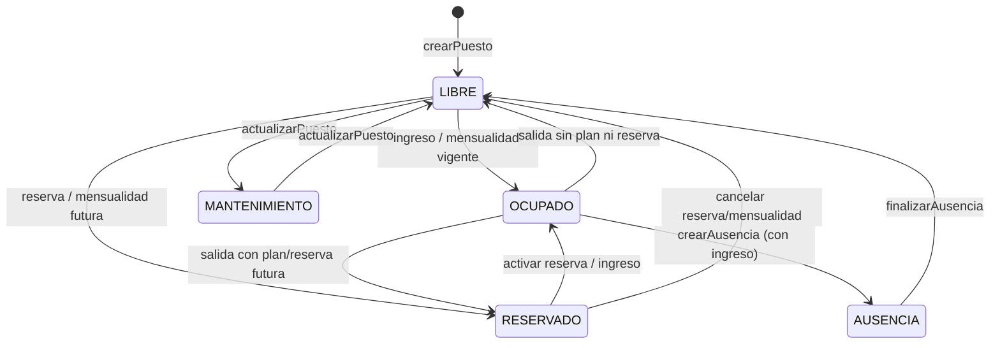
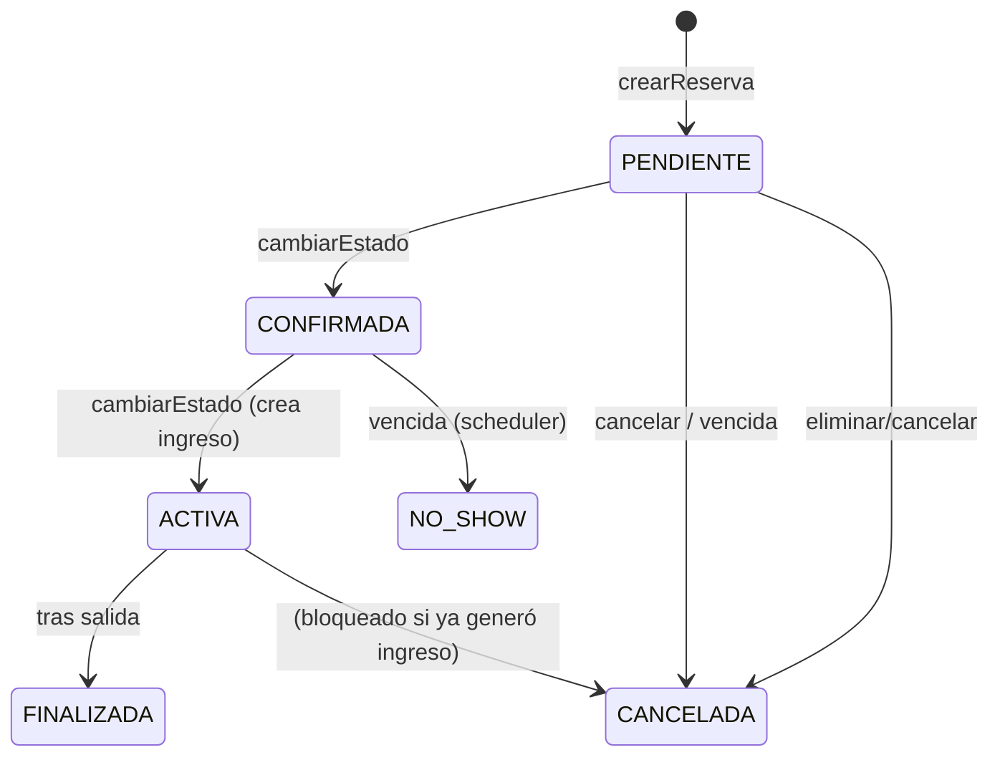
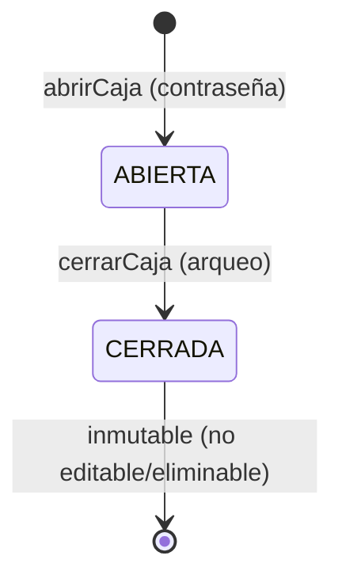
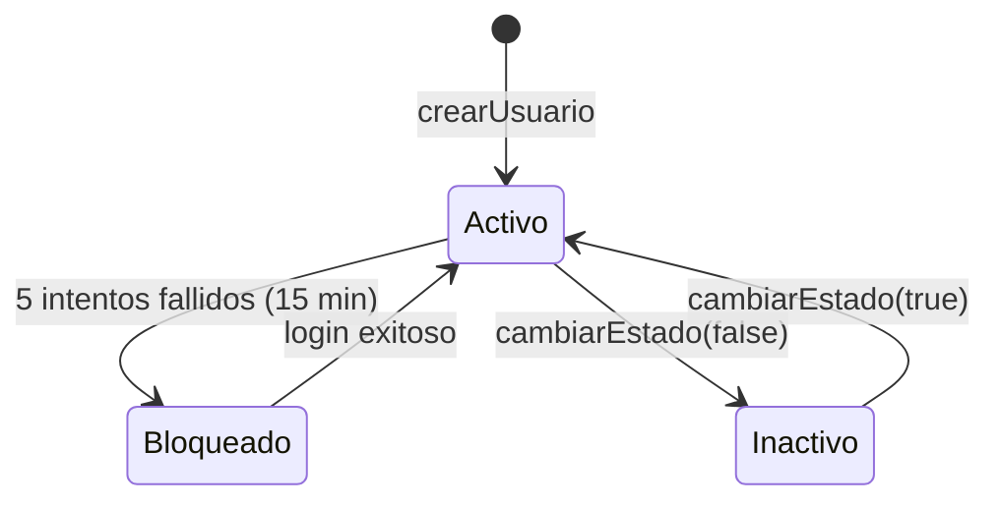
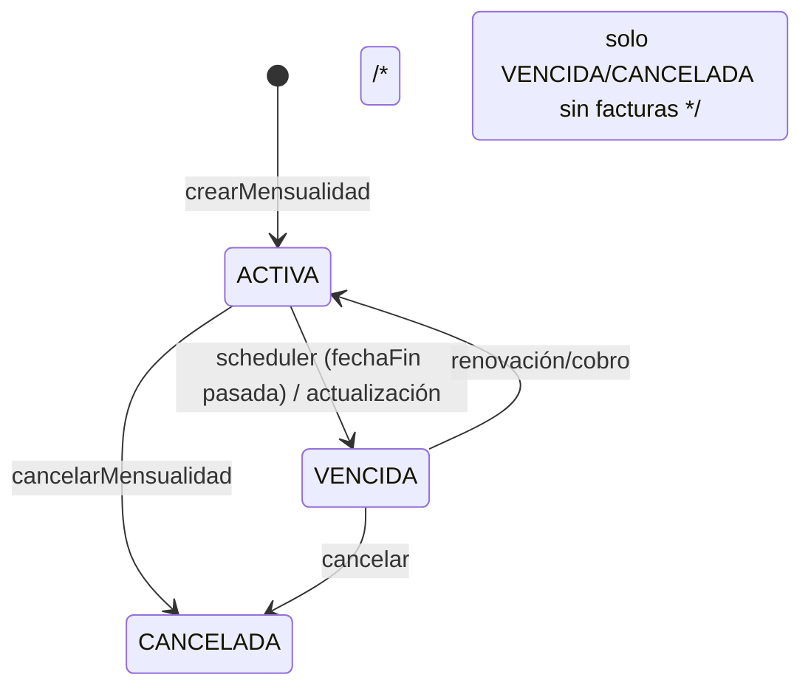

# 09 — Estados y transiciones

> Los estados se almacenan como `String` (no enums Prisma). Definidos por convención en controladores/servicios.

## 1. Vehículo
Campos: `estado` (bool), `bloqueado` (bool), `tipoCobro` (PLAN/TARIFA/NINGUNO).

| Transición | Quién | Restricción |
|---|---|---|
| crear → estado true | admin/supervisor | placa única |
| activo → suspendido (estado false) | admin al eliminar | si tiene ingresos/mensualidades/reservas/ausencias |
| bloqueado ⇄ activo | admin/supervisor (edición) | vehículo bloqueado no puede ingresar |

## 2. Ingreso

| Transición | Quién | Restricción |
|---|---|---|
| crear → ACTIVO | admin/supervisor | cliente/vehículo válidos; vehículo no dentro; puesto disponible |
| ACTIVO → FINALIZADO | admin/supervisor | salida con cobro o liberar (con plan); revalida cobertura |
| FINALIZADO → eliminado | admin | solo si NO tiene facturas |

## 3. Puesto

| Transición | Quién | Restricción |
|---|---|---|
| → OCUPADO | sistema (ingreso/mensualidad) | no desde el endpoint de puestos |
| → LIBRE/MANTENIMIENTO | admin/supervisor | solo si sin ingresos/mensualidades/reservas activas |
| → RESERVADO | reserva/mensualidad futura | |
| → AUSENCIA | ausencia con ingreso | |

## 4. Plan
`activo` (bool). Crear → activo. DELETE desactiva si hay mensualidades activas; borra si no hay ninguna. Editar activa/desactiva.

## 5. Reserva

Restricción clave: activar requiere puesto + vehículo; cancelar una reserva con ingreso generado se bloquea.

## 6. Factura
No tiene campo `estado`; su "estado de pago" se deriva de `metodoPago` (null = PENDIENTE, valor = PAGADA). Origen: INGRESO / MENSUALIDAD / MENSUALIDAD_AUTO.

## 7. Pago
Modelado como `Factura` + `CajaMovimiento`. No hay entidad `Pago`. Los abonos de suscripción generan varias facturas `FACT-MEN`.

## 8. Caja

| Transición | Quién | Restricción |
|---|---|---|
| → ABIERTA | admin/supervisor | una por sucursal; contraseña válida |
| ABIERTA → CERRADA | admin/supervisor | conteo de denominaciones válido |
| CERRADA → nada | — | inmutable |

**CajaMovimiento**: `anulado` false → true (soft-delete con `anuladoEn/Por/motivo`); nunca se borra.

## 9. Usuario
`estado` (bool) + `bloqueadoHasta` + `tokenVersion`.

Cualquier cambio de privilegios incrementa `tokenVersion` (invalida sesiones). Protecciones: no desactivar/eliminar el último admin activo.

## 10. Mensualidad

## 11. Ausencia
`ACTIVA` → `FINALIZADA` (finalizar aplica opción sobre la mensualidad). `opcion`: HISTORIAL/EXTENDER/DESCONTAR/CONGELAR/MANTENER.
